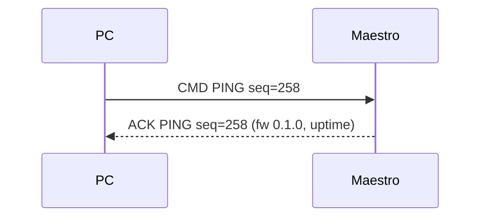
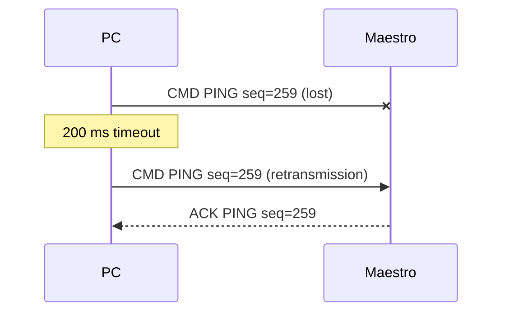
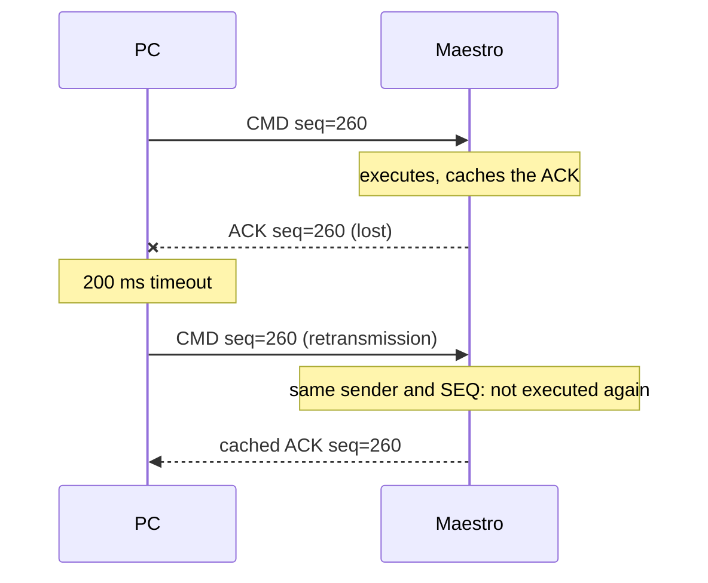
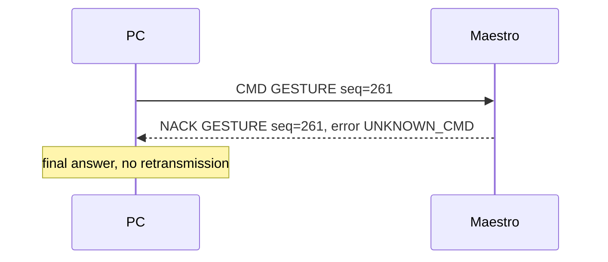
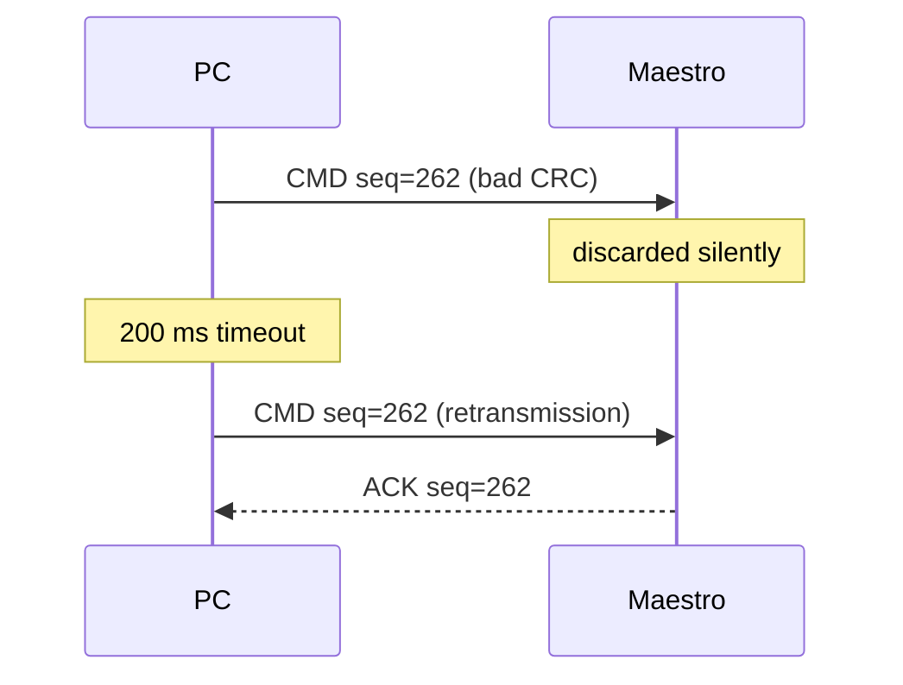

# SOFIA Communication Standard — PC ↔ Maestro (v1)

| | |
|---|---|
| **Protocol version** | 1 (`VER = 0x01`) |
| **Parties** | PC (SOFIA control application) and the ESP32 Maestro |
| **Transport** | Wi‑Fi (IEEE 802.11, ESP32 access point) + UDP/IPv4 |
| **Status** | PING implemented; other commands reserved (see §6) |

---

## 1. Scope

This document defines how the PC and the ESP32 Maestro exchange messages:
the network setup, the frame structure, the commands and their responses,
the error codes, the acknowledgement rules and the recovery from lost or
corrupted messages. Both implementations must follow it:

- PC: `sofia-tracker/comms/protocol.py` and `sofia-tracker/comms/__main__.py`
- Maestro: `sofia-firmware/src/protocol.h`, `protocol.cpp` and `main.cpp`

The key words **must**, **must not**, **should** and **may** are used as
in RFC 2119.

---

## 2. Roles

- **PC (master).** Initiates every exchange by sending a command. It
  measures timeouts, retransmits and decides when the link is lost.
- **Maestro (slave).** Never initiates an exchange. It answers every valid
  command with **exactly one** response: an ACK if the command was accepted
  and executed, or a NACK if it was rejected.

Communication is **stop‑and‑wait**: the PC must not send a new command
until the previous one was answered or abandoned (§8.2).

---

## 3. Transport

### 3.1 Network

The Maestro creates its own Wi‑Fi network; the PC joins it as a client.
No router is involved.

| Parameter | Value |
|---|---|
| Mode | ESP32 access point (soft AP) |
| SSID | `SOFIA-Maestro` |
| Security | WPA2‑PSK (password defined in `include/config.h`) |
| Channel | 6 |
| Maestro IP address | `192.168.4.1` (fixed), netmask `255.255.255.0` |
| PC IP address | Assigned by the Maestro's DHCP server (`192.168.4.x`) |
| Maestro UDP port | `4210` |
| PC UDP port | Any (ephemeral port chosen by the operating system) |

### 3.2 Datagrams

- Each UDP datagram carries **exactly one frame**. Frames are never split
  across datagrams or packed together.
- The Maestro sends each response to the IP address and port the command
  came from.
- The largest frame is 73 bytes, well below the UDP payload limit of a
  single Wi‑Fi frame, so IP fragmentation never occurs.

UDP was chosen over TCP so that delivery, ordering and duplicate detection
are defined by this protocol (§8) rather than hidden inside the transport,
and to avoid TCP's retransmission delays on a real‑time control link.

---

## 4. Frame format

### 4.1 Structure

Multi‑byte fields are **little‑endian** (least significant byte first).

```
 0      1      2      3      5      6      7            7+LEN      9+LEN
┌──────┬──────┬──────┬─────────────┬──────┬──────┬────────────┬─────────────┐
│ SOF  │ VER  │ TYPE │    SEQ      │ CMD  │ LEN  │  PAYLOAD   │   CRC16     │
│ 0xA5 │ 0x01 │      │  (uint16)   │      │      │ (LEN bytes)│  (uint16)   │
└──────┴──────┴──────┴─────────────┴──────┴──────┴────────────┴─────────────┘
```

| Offset | Field | Size | Description |
|---|---|---|---|
| 0 | `SOF` | 1 | Start of frame. Always `0xA5`. |
| 1 | `VER` | 1 | Protocol version. `0x01` for this document. |
| 2 | `TYPE` | 1 | Frame type (§5). |
| 3 | `SEQ` | 2 | Sequence number chosen by the PC; echoed in the response (§8.1). |
| 5 | `CMD` | 1 | Command code (§6); echoed in the response. |
| 6 | `LEN` | 1 | Payload length in bytes, `0`–`64`. |
| 7 | `PAYLOAD` | `LEN` | Command‑specific data. Absent when `LEN = 0`. |
| 7 + `LEN` | `CRC16` | 2 | Checksum over bytes 1 … 6 + `LEN` (`VER` through the end of `PAYLOAD`). |

Frame size: **9 bytes** minimum (no payload), **73 bytes** maximum.

### 4.2 Checksum

The checksum is **CRC‑16/CCITT‑FALSE**:

| Parameter | Value |
|---|---|
| Polynomial | `0x1021` |
| Initial value | `0xFFFF` |
| Input / output reflected | No / No |
| Final XOR | `0x0000` |
| Check value (`"123456789"` in ASCII) | `0x29B1` |

`SOF` is excluded so that the start marker and the checksum are
independent checks. Reference implementation (C):

```c
uint16_t crc16(const uint8_t *data, size_t size) {
    uint16_t crc = 0xFFFF;
    for (size_t i = 0; i < size; ++i) {
        crc ^= (uint16_t)data[i] << 8;
        for (int bit = 0; bit < 8; ++bit)
            crc = (crc & 0x8000) ? (crc << 1) ^ 0x1021 : crc << 1;
    }
    return crc;
}
```

In Python it is `binascii.crc_hqx(data, 0xFFFF)`.

---

## 5. Frame types

| `TYPE` | Name | Direction | Meaning |
|---|---|---|---|
| `0x01` | `CMD` | PC → Maestro | A command to execute. |
| `0x02` | `ACK` | Maestro → PC | The command was accepted and executed. `PAYLOAD` holds the command's result, if any. |
| `0x03` | `NACK` | Maestro → PC | The command was rejected and **not** executed. `PAYLOAD` holds one byte: the error code (§7.1). |

A response (`ACK` or `NACK`) **must** copy `VER`, `SEQ` and `CMD` from the
command it answers. Other `TYPE` values are reserved.

---

## 6. Commands

| `CMD` | Name | Request payload | ACK payload | Status |
|---|---|---|---|---|
| `0x01` | `PING` | none | 7 bytes, see §6.1 | **Implemented** |
| `0x02` | `GET_STATUS` | none | Maestro state and counters | Reserved |
| `0x10` | `GESTURE` | 1 byte: gesture ID | none | Reserved |
| `0x11` | `SET_TARGET` | 4 bytes: x, y (uint16, 0–10000 = 0.0–1.0) | none | Reserved |

Ranges: `0x01`–`0x0F` link and diagnostics, `0x10`–`0x3F` SOFIA motion,
`0x40`–`0xFF` reserved for future use. Until a reserved command is
implemented, the Maestro answers it with `NACK UNKNOWN_CMD`.

Gesture IDs for `GESTURE`: `1` INDEX, `2` V, `3` PALM, `4` SWIPE_LEFT,
`5` SWIPE_RIGHT, `6` GRAB.

### 6.1 PING (`0x01`)

Checks that the link works and reports the firmware version and how long
the Maestro has been running. It has no side effects, so it is also the
test command for this stage.

- **Request:** `LEN = 0`. Any other length gets `NACK BAD_LENGTH`.
- **ACK payload (7 bytes):**

| Offset | Field | Type | Description |
|---|---|---|---|
| 0 | `FW_MAJOR` | uint8 | Firmware version, major |
| 1 | `FW_MINOR` | uint8 | Firmware version, minor |
| 2 | `FW_PATCH` | uint8 | Firmware version, patch |
| 3 | `UPTIME_MS` | uint32 | Milliseconds since the Maestro started (wraps after ~49.7 days) |

---

## 7. Errors

### 7.1 Rejected commands (NACK)

When a frame is valid (§7.2) but the command can't be executed, the
Maestro answers with a `NACK` whose payload is one of these codes:

| Code | Name | Meaning |
|---|---|---|
| `0x01` | `UNKNOWN_CMD` | `CMD` is not implemented. |
| `0x02` | `BAD_LENGTH` | `LEN` doesn't match what the command expects. |
| `0x03` | `BAD_PAYLOAD` | A payload value is out of range (e.g. an unknown gesture ID). |
| `0x04` | `UNSUPPORTED_VERSION` | `VER` is not a version the Maestro implements. |
| `0x05` | `BUSY` | The Maestro can't accept the command right now; the PC may retry later. |
| `0x06` | `INTERNAL` | The command failed inside the Maestro. |

A NACK is a final answer: the PC **must not** retransmit the same command
because of it (it may send a corrected command with a new `SEQ`).

### 7.2 Discarded frames (no response)

If a datagram fails any of these checks, the Maestro **must** discard it
silently. None of its fields can be trusted, so there is nothing reliable
to reply to; the PC recovers through its timeout (§8.2).

| Check | Discarded when |
|---|---|
| Size | Fewer than 9 bytes. |
| Start of frame | Byte 0 ≠ `0xA5`. |
| Length | `LEN` > 64, or the datagram size ≠ 9 + `LEN`. |
| Checksum | `CRC16` doesn't match. |
| Type | `TYPE` ≠ `CMD` (the Maestro only accepts commands). |

The PC applies the same checks to responses, and also ignores a valid
response whose `SEQ` or `CMD` doesn't match the outstanding command (a late
answer to an earlier command).

---

## 8. Communication rules

### 8.1 Sequence numbers

- The PC assigns a `SEQ` to each **new** command: the previous `SEQ` plus
  one, wrapping from `65535` to `0`. The first `SEQ` of a session should
  be random, so that a restarted PC isn't mistaken for a retransmission.
- A **retransmission** reuses the `SEQ` of the original command.

### 8.2 Timeouts and retransmission

| Parameter | Value |
|---|---|
| Response timeout | 200 ms |
| Retransmissions | 3 (4 transmissions in total) |
| Maximum wait per command | 800 ms |

The PC starts the timeout when it sends the command. If no matching
response arrives in time, it sends the **identical** frame again. After the
last retransmission times out, the command is abandoned and reported as
"no response". The Maestro should answer within 50 ms of receiving a
command.

### 8.3 Duplicate detection

A lost **response** makes the PC retransmit a command the Maestro has
already executed. To keep commands from running twice, the Maestro keeps
its last response together with the sender's IP address, port and `SEQ`:

- Same sender and same `SEQ` as the cached response → resend the cached
  response **without executing the command again**.
- Anything else → execute the command and replace the cache.

### 8.4 Link supervision

While no other command is pending, the PC should send a `PING` every
1 s. After **3 consecutive** `PING`s without a response, the PC must
consider the link lost and report it to the user. The link is restored by
the next acknowledged `PING`.

---

## 9. Sequence diagrams

### 9.1 Normal exchange



### 9.2 Lost command



### 9.3 Lost acknowledgement



### 9.4 Rejected command



### 9.5 Corrupted frame



---

## 10. Worked examples

All bytes in hexadecimal.

**PING with `SEQ = 258` (`0x0102`):**

```
A5 01 01 02 01 01 00 88 08
│  │  │  └─┬─┘ │  │  └─┬─┘
│  │  │   SEQ  │  │   CRC16 = 0x0888 over "01 01 02 01 01 00"
│  │  │        │  LEN = 0
│  │  │        CMD = PING
│  │  TYPE = CMD
│  VER = 1
SOF
```

**ACK for that PING** (firmware 0.1.0, uptime 12 345 ms = `0x00003039`):

```
A5 01 02 02 01 01 07 00 01 00 39 30 00 00 D3 D7
```

Byte by byte: `A5` SOF, `01` VER, `02` TYPE = ACK, `02 01` SEQ = 258,
`01` CMD = PING, `07` LEN, `00 01 00` firmware 0.1.0, `39 30 00 00`
uptime 12 345 ms, `D3 D7` CRC16 = `0xD7D3`.

**NACK** for an unimplemented `GESTURE` (`CMD = 0x10`) with `SEQ = 7`:

```
A5 01 03 07 00 10 01 01 E8 80
```

`03` TYPE = NACK, `07 00` SEQ = 7, `10` CMD = GESTURE, `01` LEN,
`01` error = UNKNOWN_CMD, `E8 80` CRC16 = `0x80E8`.

---

## 11. Versioning

- `VER` changes only for changes that older implementations can't
  understand (a new header layout or a different checksum).
- New commands, new error codes and longer payloads for new commands do
  **not** change `VER`: an older Maestro answers unknown commands with
  `NACK UNKNOWN_CMD`, which the PC can handle.
- A Maestro that receives a valid frame with an unknown `VER` answers
  `NACK UNSUPPORTED_VERSION`.

---

## 12. Implementation status

| Element | PC (`comms/`) | Maestro (firmware 0.1.0) |
|---|---|---|
| Frame encoding/decoding, CRC | ✅ | ✅ |
| Discard rules (§7.2) | ✅ | ✅ |
| `PING` | ✅ (`python -m comms ping`) | ✅ |
| `NACK UNKNOWN_CMD` / `BAD_LENGTH` / `UNSUPPORTED_VERSION` | ✅ (reported) | ✅ (sent) |
| Timeout and retransmission (§8.2) | ✅ | n/a |
| Duplicate detection (§8.3) | n/a | ✅ |
| Link supervision (§8.4) | Planned (GUI integration) | n/a |
| `GET_STATUS`, `GESTURE`, `SET_TARGET` | Planned | Planned |
